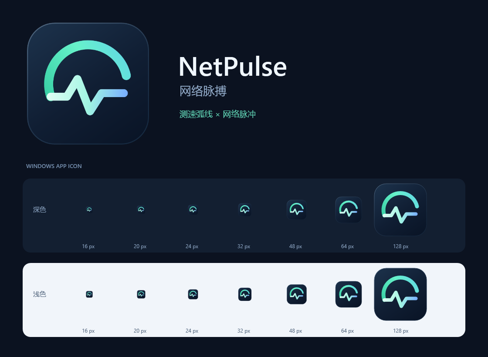

# NetPulse 网络脉搏（NetSpeedTest）

Windows x64 中文网络测速与波动监测工具。发布产物为 **`dist/NetPulse.exe` 一个文件**，无需安装 .NET，无需管理员权限。复制 EXE 后即可运行。

**[下载最新单文件 EXE](https://github.com/boooooommmmmm/NetSpeedTest/releases/latest/download/NetPulse.exe)** · [所有版本与发布说明](https://github.com/boooooommmmmm/NetSpeedTest/releases) · [发布流程](docs/releasing.md)

## 应用图标

图标以薄荷绿测速弧线连接网络脉冲，搭配深蓝圆角底板；EXE、窗口标题栏、任务栏和界面左上角使用同一套图形。ICO 内含 16、20、24、32、40、48、64、96、128、256 像素的 32 位透明图像，其中 16～32 像素加粗笔画，适应小尺寸显示。



[ICO](src/NetPulse/Assets/NetPulse.App.ico) · [1024 像素透明 PNG](src/NetPulse/Assets/NetPulse.App.png) · [SVG](src/NetPulse/Assets/NetPulse.App.svg) · [WPF 矢量源](src/NetPulse/Assets/NetPulse.Icon.xaml)。修改矢量源后运行 `pwsh -NoProfile -STA -File tools/build-icon.ps1`，即可重新生成 ICO、PNG、SVG 和预览图，无需额外图形工具。随后重新运行构建；分发仍只需一个 EXE。

## 使用

1. 双击 `dist/NetPulse.exe`。
2. 输入要监测的 IP / 域名，默认 `223.5.5.5`；也可以点击“网关”填入当前 IPv4 网关。
3. 测速源默认“Speedtest.net · Ookla 节点”，也可切换“测速网 SpeedTest.cn · 国内”、Cloudflare 或自定义。程序启动时恢复所选节点源的缓存，自动同步开启且列表到期时会同步公开节点和 IP；没有缓存时先获取节点。点击“开始测速”，使用所选节点，采集 3 秒空闲延迟，依次测试下载、上传，再采集恢复期延迟。自动开启的监测在测速结束后停止。也可先点“立即同步”，再手动选择节点；同步期间可点“取消选点”。
4. 若要长时间检查网络，点击“开始监测”。手动开启的监测会持续运行，测速结束后也会继续。新监测会话会清空上一会话记录；需要保留时先导出。
5. 点击“导出 CSV”保存记录，可用 Excel 打开；包含时间、目标、探测方式、空闲/下载/上传阶段、延迟和失败详情。
6. 顶部“检查更新”检查 GitHub 新版本；发现新版后可查看说明并下载新的单文件 EXE。

默认每个测速项目最多运行 10 秒，使用 4 条并发连接，每项有效负载上限 256 MiB。可在“测速设置与自定义节点”中选择 5/10/20 秒、2/4/8 条连接和 64/256/1024 MiB 上限。测速会产生真实网络流量，协议开销、预读及未确认上传不计入界面上的有效数据量；流量上限并非运营商账单的精确字节上限。随时点击“停止测速”可取消。

## 定时同步测速 IP

v1.4 默认从 **Speedtest.net** 同步节点，每 **15 分钟**更新一次，可改为 **5 / 15 / 30 / 60 分钟**，也可关闭自动同步。选择测速网时则同步测速网节点。程序保存最近选择的节点源、勾选状态、间隔和系统代理选项，重启后恢复；升级前的开关、间隔和代理选项也会保留。

- 同步从所选节点源获取公开列表，检测 HTTP 可达性，并解析下载节点域名的 IPv4 / IPv6 地址；不会自动进行下载、上传带宽测试。Speedtest.net 节点还检查标准延迟响应，避免把登录页当作可用节点。
- “立即同步”随时更新一次，自动同步关闭时也可使用。
- 展开“已同步的测速 IP 列表”，可查看节点名称、域名、解析出的 IP 和 HTTP 探测结果；上方显示上次成功时间、节点数量及下一次计划时间。
- 测速进行中暂停同步；测试完成后由下一次定时检查补做，避免同步流量干扰带宽测试。
- 同步失败、超时或取消时保留上次成功的节点与缓存；自动同步开启时在 1 分钟后重试。没有缓存时会显示同步错误，不能凭空生成节点。
- 更新列表时保留仍然存在的已选节点，以及已完成的测速结果、延迟曲线和探测记录。节点从列表中移除时，会选择新列表中的可达节点。
- Speedtest.net 与测速网分别保存列表、选中节点和上次同步时间，切换时恢复对应缓存，不会混用节点或测速协议。切换到 Cloudflare 或自定义源时，继续更新最近选择的节点源缓存，界面会标明来源，并保留当前测速源与自定义 URL。
- 定时任务仅在软件运行期间工作；关闭软件后停止，不安装系统服务或计划任务。

解析出的 IP 用于查看和缓存；HTTPS 测速继续使用原始域名，以保持证书校验、SNI 和正常 DNS 路由。使用 HTTP 代理时，代理实际连接的地址可能与本机 DNS 显示的地址不同。单个节点 DNS 解析失败时显示“未解析”，不会编造 IP。

## GitHub 版本检查

v1.3 默认在软件运行期间每 **6 小时**检查一次官方仓库 `boooooommmmmm/NetSpeedTest`；启动时读取上次检查时间，已经到期或从未检查时会检查。可以关闭自动检查，或随时点击“检查更新”。

- 使用公开 GitHub Releases API 获取正式最新版本；API 连接失败时改读同一官方仓库的 `release/latest.json`，仅接受 HTTPS 的官方仓库版本及 EXE 地址。
- 版本按数值比较，忽略草稿和预发布版本。发现新版后显示版本号、大小、“发布说明”和“下载新版”入口。
- 自动检查仅获取小体积版本信息。下载由用户点击触发，并选择保存位置；保存前验证 GitHub 发布的大小与 SHA-256。
- 下载期间可取消；失败或校验不符会删除下载片段，保留目标位置原来的文件。新版保存完成后，关闭旧版再运行新文件，用户设置与节点缓存继续保留。
- 检查失败保留已发现的新版信息，并在 15 分钟后重试。测速或下载期间顺延版本检查；下载新版时暂缓节点同步和带宽测速。
- 检查与下载使用 Windows 系统 HTTP 代理设置。测速设置中的代理开关仅控制测速和测速网节点同步。
- 自动检查设置、上次检查时间和已发现的发布信息保存到 `%LOCALAPPDATA%\NetPulse\updates.json`，关闭程序后定时检查停止。

客户端通过 GitHub 官方 HTTPS 元数据取得 SHA-256，并验证下载完整性；该机制不是独立发布者签名或 Windows 代码签名。当前提供检查、提示和手动下载新 EXE，升级由用户关闭旧文件后运行新文件完成。发布者操作见[发布流程](docs/releasing.md)。

## 指标含义

- **下载 / 上传 Mbps**：实际二进制数据量 × 8 ÷ 实际耗时；`1 MB/s = 8 Mbps`。测试进行时显示最近约 400 毫秒的速度，结束后显示整个项目的平均速度。耗时包含连接和请求开销。上传只计入收到成功 HTTP 响应的完整请求。
- **当前延迟**：最近一次成功探测的往返耗时；失败显示“失败”。ICMP 使用系统返回的毫秒值，局域网内可能为 `0 ms`。
- **平均 / P95 / 最低 / 最高**：本监测会话中成功样本的统计。P95 使用最近秩法，失败样本不参与延迟分布。
- **抖动**：连续成功样本之间延迟绝对差的平均值。失败会中断相邻关系；不足一对成功样本时显示横线。
- **丢包 / 失败率**：失败探测数 ÷ 总探测数。ICMP 无回应可能源于过滤或限速；TCP 失败可能源于端口关闭、DNS 或连接超时，不能直接等同于链路的实际丢包率。
- **负载延迟**：测试状态中对比空闲、下载和上传阶段的平均延迟。采样归属按探测开始时的阶段确定；流量上限导致项目很快结束时，可能没有该阶段的延迟样本，此时显示横线。

延迟图保留最近 180 次探测，红线标记失败，上传阶段使用蓝色。列表展示最近 60 条记录，CSV 保留本会话所有记录。会话最多 100,000 条，达到上限自动停止；探测按串行方式进行，若一次探测超过设定间隔，则等它结束后再发起下一次。

## 节点与网络

默认使用 [Speedtest.net 公开节点接口](https://www.speedtest.net/api/js/servers?engine=js&limit=30&https_functional=true)，按接口给出的距离顺序取得候选节点；JSON 接口失败时尝试同站点的 XML 公开列表。只生成 HTTPS 测速地址，使用接口公布的主机名（包括证书对应的 `ooklaserver.net` 别名），保持正常 TLS 证书校验。通过节点的 `latency.txt` 进行小流量探测，下载使用 `random2000x2000.jpg`，上传使用 `upload.php`；下载校验 JPEG 标识，上传校验服务器确认收到的字节数，防止错误页面或未确认的上传被算入速度。

也可切换[测速网 SpeedTest.cn](https://www.speedtest.cn/)网页所用的公开节点接口，排除私有/受限节点与需要其他协议的 CDN 签名节点。两种节点源均对最多 12 个候选节点进行小流量 HTTP 可达性探测，初次选择时优先使用耗时较低的可达节点。列表会缓存到本机，并按配置的周期同步，也可手动同步；关闭自动同步后仍可使用缓存。节点探测显示的毫秒数包含 HTTP 连接和请求开销，不能等同于 ICMP Ping；低延迟也不保证带宽最高。

测速网下载接口使用 `size` 参数触发二进制传输；部分节点返回固定大小内容，程序按实际接收的字节数和耗时计算，仍受本地流量上限约束。同步失败时明确显示状态并保留缓存，不会自动切换为 Cloudflare。该接口来源于公开网页，并非正式 SDK 合约；网站接口变化时可能需要更新本软件。

顶部可切换“Cloudflare · 国际对照”，使用其[公开下载与上传接口](https://github.com/cloudflare/speedtest)；也可选择“自定义 HTTP 节点”后在展开的设置中编辑 URL。预设源的 URL 只读，防止界面选定的来源与实际请求不一致。程序独立实现 HTTP 吞吐测量，未集成 Ookla 官方客户端或各网站的完整测速引擎，结果不保证与网页或官方 App 相同。公开目录及节点接口可能变化；不支持 HTTP 测速的节点会报告失败，可更换节点或来源。

跨境路由、服务器限流、Wi-Fi、VPN、系统代理和其他程序占用都会影响结果。结果描述的是本机到所选节点的实际吞吐，不等同于运营商套餐带宽。可以切换不同源和节点进行对比；单次差异不足以证明某个节点固定限速。若需要自定义，使用自己可访问、明确允许测速的服务：

- 下载 URL：返回未压缩二进制内容的 GET 地址。程序替换/附加 `bytes` 参数指定请求大小，并附加随机 `netpulse` 参数避免缓存。普通下载地址必须允许附加查询参数。
- 上传 URL：接受原始 `application/octet-stream` POST 并在接收完请求体后返回成功响应的地址；留空只测试下载。程序也会附加 `bytes` 和 `netpulse` 参数。
- 程序拒绝将网页、JSON、压缩响应或空内容作为成功下载测速结果，避免把测速网不带 `size` 参数时返回的短文本当成有效测速流量。
- ICMP 目标可与测速节点不同。例如同时监测网关可以观察局域网，监测公网地址可以观察外网链路。
- ICMP 不可用时可改用 TCP，并输入已知开放的端口，例如 HTTPS 服务的 `443`。TCP 指标包括名称解析和连接建立时间，不包含 TLS 握手。
- HTTP 测速、测速网节点获取和可达性探测默认直接连接；勾选“使用系统代理测速”后均使用系统代理。修改代理选项后会重新选择节点。ICMP / TCP 探测不经过 HTTP 代理；系统级 VPN / TUN 可能仍会影响所有流量。

程序没有账户、遥测或后台服务。网络连接用于用户触发的探测、测速、下载新版本，以及开启后的定期节点同步和 GitHub 版本检查；不上传 CSV 记录。测速服务仍可看到建立连接所需的来源 IP 和测试流量。分发的客户端使用公开更新地址，无需 GitHub 账号或发布令牌。

## 单文件行为

EXE 已打包 .NET 和 WPF 运行库，体积约 62 MiB。无需随附 DLL 或配置文件。[.NET 单文件发布](https://learn.microsoft.com/en-us/dotnet/core/deploying/single-file/)会在首次启动时把原生运行库解压到 `%TEMP%\.net\NetPulse\...`，所以首次启动可能稍慢；这不需要用户安装或维护依赖。

同步设置保存到 `%LOCALAPPDATA%\NetPulse\settings.json`，测速网节点/IP 缓存为 `nodes-v1.json`，Speedtest.net 缓存为 `nodes-speedtest-net-v1.json`，版本检查状态为 `updates.json`。旧版测速网缓存可继续读取。写入时先保存临时文件，再替换原文件；损坏或格式无效的缓存会被忽略。分发时仍只需 EXE，这些文件不需要一起复制。其他测速设置、测速结果和探测记录保留在内存中，用户选择导出时保存 CSV。

## 源码与构建

需要 Windows x64 和 .NET 10 SDK。应用和测试均不依赖第三方 NuGet 包。

```powershell
# 运行验证，并发布单文件到 dist
.\build.ps1

# 仅运行核心测试
dotnet run --project tests/NetPulse.Tests/NetPulse.Tests.csproj -c Release

# 核心测试后，对比测速网和 Cloudflare（每项最多 5 秒 / 64 MiB，实际联网）
dotnet run --project tests/NetPulse.Tests/NetPulse.Tests.csproj -c Release -- --compare-online

# 仅发布
dotnet publish src/NetPulse/NetPulse.csproj -c Release -o dist

# 对发布 EXE 做界面冒烟测试，结果与截图写入指定目录
$smokeOutput = Join-Path (Get-Location) 'artifacts\smoke'
Start-Process -FilePath .\dist\NetPulse.exe -ArgumentList '--smoke-test', $smokeOutput -WindowStyle Hidden -Wait

# 加 --online 可实际测试 Cloudflare（各项最多 5 秒 / 32 MiB）
Start-Process -FilePath .\dist\NetPulse.exe -ArgumentList '--smoke-test', $smokeOutput, '--online' -WindowStyle Hidden -Wait

# 使用测速网做完整界面冒烟测试，包含动态获取、自动选点和实际下载/上传
Start-Process -FilePath .\dist\NetPulse.exe -ArgumentList '--smoke-test', $smokeOutput, '--speedtest-cn' -WindowStyle Hidden -Wait

# 使用 Speedtest.net 做完整界面冒烟测试，包含节点和 IP 同步、实际下载/上传
Start-Process -FilePath .\dist\NetPulse.exe -ArgumentList '--smoke-test', $smokeOutput, '--speedtest-net' -WindowStyle Hidden -Wait

# 正式发布后，验证实际客户端的 GitHub 检查入口
Start-Process -FilePath .\dist\NetPulse.exe -ArgumentList '--smoke-test', $smokeOutput, '--check-github' -WindowStyle Hidden -Wait

# 验证公开 Release、旧版升级识别及真实 EXE 下载和哈希
dotnet run --project tests/NetPulse.Tests/NetPulse.Tests.csproj -c Release -- --verify-github
```

路径含空格时，将整个输出目录作为一个带引号的参数传给 `-ArgumentList`。正常启动在自动同步或版本检查开启且到期时执行相应网络请求；带宽测速和持续探测需要点击相应按钮。冒烟测试把设置和缓存写入指定输出目录内的 `appdata`，不会改动日常使用的用户配置。

`src/NetPulse.Core` 为网络、统计、同步计划和缓存逻辑，`src/NetPulse` 为 WPF 界面，`tests/NetPulse.Tests` 为无第三方依赖的本地测试程序。31 项测试使用回环 HTTP 服务验证传输字节数、上传确认、流量上限、超时、取消与失败分支，并验证真实回环 ICMP / TCP / DNS。同步测试覆盖到期时间、忙时顺延、失败重试、分来源缓存、旧版文件兼容、设置恢复及损坏文件。EXE 冒烟测试还逐一验证两种节点源的实际界面同步状态、缓存恢复、选中节点和已有测速结果保留。
